<!-- ============================ HEADER ============================ -->


  

  
  
  
  

  
  
  
  
  

<!-- ============================ ABOUT ============================ -->

  <b>Hey there, I'm Kavishan 👋</b> 
  A <b>Software Engineering Undergraduate</b> and <b>IT Systems &amp; Support Professional</b> who loves turning real-world problems into 
  practical, reliable solutions — from debugging systems and writing SQL to building full-stack apps and ML models.




  
  
  
  
  

### 🔭 Right now

- 🏗️ Building **real projects** across full-stack, data analytics and machine learning
- 🔐 Strengthening my **AWS cloud and cybersecurity** skills
- 🤖 Exploring **Generative AI** and the **Gemini API** in practical apps
- 🤝 Looking for **internships and junior roles** in software engineering, data/AI and IT systems

### 💡 How I work

- ✅ **Practical first**: I build things that solve a real problem
- 🧪 **Test everything**: automated tests, documented test cases, security checks
- 🔁 **Always improving**: small iterations, fast feedback, clean code

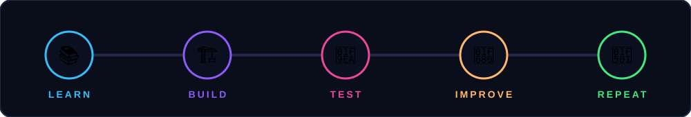


<h3 align="center">💻 Languages</h3>

  

<h3 align="center">🌐 Frameworks & Web</h3>

  

<h3 align="center">🗄️ Databases & Data</h3>

  
   
  
  
  
  

<h3 align="center">🤖 ML & AI</h3>

  
   
  
  
  
  

<h3 align="center">☁️ Cloud, DevOps & Tools</h3>

  

  
  
  
  

<!-- ============================ PROJECTS ============================ -->

<table align="center">
<tr>
<td align="center"><a href="https://github.com/Kavishan05/Loan-Document-Verification-System"></a></td>
<td align="center"><a href="https://github.com/Kavishan05/The-Ocean-View-Resort-Online-Room-Reservation-System-"></a></td>
</tr>
<tr>
<td align="center"></td>
<td align="center"></td>
</tr>
<tr>
<td align="center"><a href="https://github.com/Kavishan05/Baseball-Club-Automation-System"></a></td>
<td align="center"><a href="https://github.com/Kavishan05/The-Paws-Shop-Automated-Pet-Shop-Management-System"></a></td>
</tr>
<tr>
<td align="center"><a href="https://github.com/Kavishan05/FitZone-Fitness-Center-Website"></a></td>
<td align="center"></td>
</tr>
</table>

<!-- ============================ FOCUS ============================ -->

<h3 align="center">📌 Pinned Repositories</h3>

  
    
  
  


<!-- ============================ STATS ============================ -->

  
  

  

  
  
  

  

<h3 align="center">🏆 Trophies</h3>

  

<h3 align="center">🐍 Contribution Snake</h3>

  

<!-- ============================ CERTS ============================ -->

  
  
  
  
  


<!-- ============================ CONNECT ============================ -->

<h3 align="center">🌱 Currently Exploring</h3>

  
  
  
  

  

  
  
  
  

<i>"Code is like humor. When you have to explain it, it's bad."</i>

  

